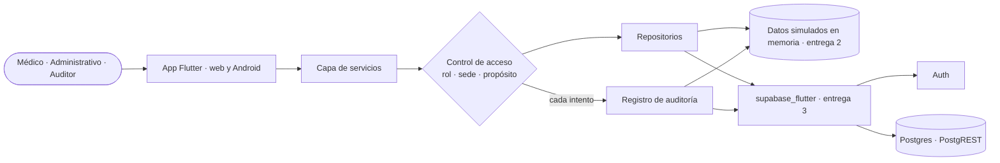

# Architectural spine · Red Vitalys

## Resumen

Red Vitalys es una app para la Dirección Médica y el personal clínico. Unifica la historia del paciente, muestra los indicadores de calidad por sede y el riesgo de reingreso, y audita cada acceso. Corre en el navegador web y en Android. En la entrega 2 funciona con datos simulados en memoria, y en la entrega 3 se conecta a Supabase (Auth y Postgres con PostgREST), sin backend propio.

## Diagrama

## Stack

- Frontend: Flutter 3.x y Dart 3.x. Plataformas: web y Android (iPhone no se incluye).
- Estado y navegación: lo que trae Flutter. El estado se maneja con `setState` en la Screen anfitriona y la navegación con la de Flutter. No se usan paquetes de estado ni de navegación.
- SDK: `supabase_flutter`, que es el único paquete agregado.
- Backend: Supabase con Auth y la base de datos (Postgres + PostgREST). Storage no se usa.
- Entrega 2: sin conexión a Supabase. Todos los datos son simulados y viven en memoria.

## Qué cubre cada servicio

- **Auth**: inicio y cierre de sesión con correo institucional y contraseña. Las cuentas ya existen y no hay registro desde la app. Auth no guarda el rol ni la sede.
- **Base de datos**: pacientes y sus identificadores en cada sistema de origen, sistemas de origen, sedes, atenciones, predicciones de riesgo de reingreso con sus factores, indicadores con sus mediciones, usuarios, roles y eventos de auditoría. El detalle irá en `docs/modelo.md`.
- **Storage**: no se usa en esta versión.

## Invariantes

### AD-01 · Sin backend propio

- **Regla:** la app habla directo con Supabase por medio de `supabase_flutter`, sin servidores intermedios.
- **Evita:** que alguien monte un servidor aparte para una sola funcionalidad y la app quede con dos backends.

### AD-02 · Un contrato, dos fuentes

- **Regla:** cada repositorio tiene una interfaz y dos implementaciones: una en memoria con los datos simulados (entrega 2) y una con Supabase (entrega 3). La fuente se elige en un solo punto de la app, y los datos simulados salen de un único conjunto compartido que cumple RNF-04.
- **Evita:** reescribir las pantallas al conectar Supabase, y que cada integrante invente sus propios datos de prueba.

### AD-03 · Solo los servicios piden datos

- **Regla:** las pantallas les piden los datos a los servicios. Solo los repositorios hablan con la fuente de datos, sea la memoria o Supabase.
- **Evita:** consultas distintas a la misma información regadas por las pantallas, que además se saltarían el control de acceso y la auditoría.

### AD-04 · Identidad de Auth, rol en la base

- **Regla:** Auth solo autentica. El usuario de la base se identifica con el `uuid` de Auth, y de ese registro salen su rol y sus permisos. Nunca se leen de los metadatos de Auth.
- **Evita:** dos identidades para la misma persona y roles que se contradicen según de dónde se lean.

### AD-05 · La sede vive en la sesión; el propósito, en cada consulta

- **Regla:** la sede se elige al iniciar sesión, se guarda en la sesión de la app (no en Auth) y se muestra en el perfil. El propósito no se guarda en la sesión: se declara en cada consulta a la información de un paciente (RF-19). Tanto la sede de la sesión como el propósito de esa consulta viajan en su evento de auditoría.
- **Evita:** que un propósito declarado una vez se herede en consultas siguientes, y que haya eventos sin sede o sin propósito.

### AD-06 · Un solo punto de control

- **Regla:** toda acción sobre los datos pasa por el control de acceso, que decide si se permite o se deniega con una única matriz de permisos por rol, junto con la sede y el propósito. Las pantallas pueden ocultar opciones, pero quien decide es el control. El perfil (RF-22) se arma con esa misma matriz.
- **Evita:** reglas de permisos copiadas en cada pantalla que se contradicen, y un perfil que muestre permisos distintos de los que se aplican.

### AD-07 · Todo intento se audita

- **Regla:** el control de acceso escribe un evento por cada inicio de sesión y por cada intento de consultar o registrar información de un paciente, se permita o se deniegue. Cada evento lleva quién, cuándo, la acción, el recurso, el propósito, el resultado y la sede. Los accesos con propósito *Urgencia* quedan marcados como emergencia.
- **Evita:** huecos en la auditoría porque una funcionalidad se olvidó de registrar sus accesos.

### AD-08 · Auditoría solo de agregar

- **Regla:** los eventos de auditoría solo se agregan. Ningún servicio ni repositorio ofrece la opción de actualizarlos ni de borrarlos.
- **Evita:** que el registro de accesos se pueda alterar y pierda su valor como prueba.

### AD-09 · Un paciente, muchos identificadores

- **Regla:** la app identifica siempre al paciente por su id unificado. Los identificadores de cada sistema de origen son datos del paciente y nunca la llave.
- **Evita:** que el mismo paciente aparezca duplicado o que se mezclen las atenciones de dos personas distintas.

### AD-10 · El riesgo llega calculado

- **Regla:** la app muestra la predicción de riesgo y sus factores tal como están guardados, sin calcular el riesgo. El umbral de alerta (70) se define en un solo lugar.
- **Evita:** puntajes distintos para el mismo paciente y alertas que cambian según la pantalla.

### AD-11 · Las reglas de indicadores en un solo lugar

- **Regla:** cada indicador declara su dirección. En reingreso hospitalario a 30 días, tiempo de espera promedio y eventos adversos evitables es mejor un valor más bajo, y en adherencia a protocolos clínicos es mejor uno más alto. El promedio de la red, el cambio frente al periodo anterior y la marca de mejor o peor se calculan en un único servicio a partir de esa dirección.
- **Evita:** que una sede salga como mejor en el tablero y como peor en el detalle, o que el reingreso alto se marque como bueno.

### AD-12 · Formato en un solo lugar

- **Regla:** las fechas ("30 oct 2026"), las horas (formato de 24 horas) y los nombres de meses en español se formatean a mano en un único punto de la app, sin paquetes adicionales.
- **Evita:** fechas con formatos distintos según la pantalla.

### AD-13 · Llaves fuera del código

- **Regla:** la URL y la publishable key de Supabase se leen de la configuración. La secret key nunca va en la app ni en el repositorio.
- **Evita:** cambiar de proyecto editando diez archivos, y filtrar una llave con permisos totales.

## Diferido

- **RLS (condición obligatoria antes de usar datos reales).** En esta versión el control de acceso corre solo en la app, así que cualquiera con la publishable key podría leer las tablas saltándoselo. Esto se acepta porque todos los datos son simulados. Antes de cargar datos reales hay que activar RLS para que el control no dependa solo de la app.
- **El cálculo real del riesgo de reingreso.** En esta versión las predicciones y sus factores son simulados.
- **`docs/modelo.md`.** El detalle de las tablas se escribe antes de conectar Supabase en la entrega 3.
- **Edge Functions y Realtime.** No se usan. Se revisarían si la auditoría o el riesgo tuvieran que calcularse fuera de la app.
- **Storage.** Se decide si en algún momento la app maneja archivos.

## Historial

- 0.1.0 · 2026-11-05 · Primera versión.
