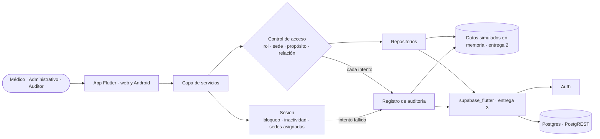

# Architectural spine · Red Vitalys

## Resumen

Red Vitalys es una app para la Dirección Médica y el personal clínico. Unifica la historia del paciente, muestra los indicadores de calidad por sede y el riesgo de reingreso, y audita cada acceso. Corre en el navegador web y en Android. En la entrega 2 funciona con datos simulados en memoria, y en la entrega 3 se conecta a Supabase (Auth y Postgres con PostgREST), sin backend propio.

## Diagrama

## Stack

- Frontend: Flutter 3.x y Dart 3.x. Plataformas: web y Android (iPhone no se incluye).
- Estado y navegación: lo que trae Flutter. El estado se maneja con `setState` en la Screen anfitriona y la navegación con la de Flutter. No se usan paquetes de estado ni de navegación.
- SDK: `supabase_flutter`, que es el único paquete agregado.
- Backend: Supabase con Auth y la base de datos (Postgres + PostgREST). Storage no se usa.
- Entrega 2: sin conexión a Supabase. Todos los datos son simulados y viven en memoria.

## Qué cubre cada servicio

- **Auth**: inicio y cierre de sesión con correo institucional y contraseña. Las cuentas ya existen y no hay registro desde la app. Auth no guarda el rol ni la sede.
- **Base de datos**: pacientes y sus identificadores en cada sistema de origen, sistemas de origen, sedes, atenciones, predicciones de riesgo de reingreso con sus factores, indicadores con sus mediciones, usuarios con su rol y sus sedes asignadas, y eventos de auditoría. El detalle irá en `docs/modelo.md`.
- **Storage**: no se usa en esta versión.

## Invariantes

### AD-01 · Sin backend propio

- **Regla:** la app habla directo con Supabase por medio de `supabase_flutter`, sin servidores intermedios.
- **Evita:** que alguien monte un servidor aparte para una sola funcionalidad y la app quede con dos backends.

### AD-02 · Un contrato, dos fuentes

- **Regla:** cada repositorio tiene una interfaz y dos implementaciones: una en memoria con los datos simulados (entrega 2) y una con Supabase (entrega 3). La fuente se elige en un solo punto de la app, y los datos simulados salen de un único conjunto compartido que cumple RNF-04.
- **Evita:** reescribir las pantallas al conectar Supabase, y que cada integrante invente sus propios datos de prueba.

### AD-03 · Solo los servicios piden datos

- **Regla:** las pantallas les piden los datos a los servicios. Solo los repositorios hablan con la fuente de datos, sea la memoria o Supabase.
- **Evita:** consultas distintas a la misma información regadas por las pantallas, que además se saltarían el control de acceso y la auditoría.

### AD-04 · Identidad de Auth, rol y sedes en la base

- **Regla:** Auth solo autentica. El usuario de la base se identifica con el `uuid` de Auth, y de ese registro salen su rol, sus permisos y sus sedes asignadas. Nunca se leen de los metadatos de Auth.
- **Evita:** dos identidades para la misma persona y roles o sedes que se contradicen según de dónde se lean.

### AD-05 · La sede vive en la sesión; el propósito, en cada consulta

- **Regla:** la sede se elige al iniciar sesión solo entre las sedes asignadas al usuario (RF-18), se guarda en la sesión de la app (no en Auth) y se muestra en el perfil. El propósito no se guarda en la sesión: se declara en cada consulta a la información de un paciente, al abrir la lista de pacientes con alta reciente y al registrar una atención (RF-19). Tanto la sede de la sesión como el propósito de esa consulta viajan en su evento de auditoría.
- **Evita:** que un propósito declarado una vez se herede en consultas siguientes, que se ingrese desde una sede no asignada y que haya eventos sin sede o sin propósito.

### AD-06 · Un solo punto de control

- **Regla:** toda acción sobre los datos pasa por el control de acceso, que decide si se permite o se deniega con una única matriz de permisos (acciones y propósitos por rol), junto con la sede y la relación entre el médico y el paciente (RF-25). Las pantallas pueden ocultar opciones, pero quien decide es el control, y el mensaje de rechazo según la causa, sin datos del paciente, lo arma él mismo (RF-21). El perfil (RF-22) se arma con esa misma matriz.
- **Evita:** reglas de permisos copiadas en cada pantalla que se contradicen, y un perfil que muestre permisos distintos de los que se aplican.

### AD-07 · Todo intento se audita

- **Regla:** el control de acceso escribe un evento por cada inicio de sesión, exitoso o fallido, por cada intento de consultar o registrar información de un paciente, por cada registro de una medición, por cada apertura de la lista de pacientes con alta reciente y por toda acción denegada, se permita o se deniegue. El evento se escribe antes de ejecutar la acción; el de un inicio de sesión exitoso, al confirmar la sede y antes de abrir la sesión. Si el evento no se puede escribir, la acción no se ejecuta. Cada evento lleva quién, cuándo, la acción, el recurso, el propósito, el resultado y la sede, salvo el inicio de sesión fallido, que todavía no tiene sesión y por eso no lleva sede. En un inicio de sesión fallido, quién es el correo con el que se intentó y el evento lleva además la IP (AD-15). La búsqueda de pacientes, que solo muestra nombre y documento, no se audita, salvo que el rol la rechace: entonces queda como acción denegada. Abrir la historia de un paciente crea dos eventos, el de *Historia clínica* y el de *Riesgo de reingreso*. No son eventos el intento de ingreso con campos vacíos ni la medición ni la atención que la validación rechaza. Los accesos con propósito *Urgencia* quedan marcados como emergencia.
- **Evita:** huecos en la auditoría porque una funcionalidad se olvidó de registrar sus accesos.

### AD-08 · Auditoría solo de agregar

- **Regla:** los eventos de auditoría solo se agregan. Ningún servicio ni repositorio ofrece la opción de actualizarlos ni de borrarlos.
- **Evita:** que el registro de accesos se pueda alterar y pierda su valor como prueba.

### AD-09 · Un paciente, muchos identificadores

- **Regla:** la app identifica siempre al paciente por su id unificado. Los identificadores de cada sistema de origen son datos del paciente y nunca la llave.
- **Evita:** que el mismo paciente aparezca duplicado o que se mezclen las atenciones de dos personas distintas.

### AD-10 · El riesgo llega calculado

- **Regla:** la app muestra la predicción de riesgo y sus factores tal como están guardados, sin calcular el riesgo. El umbral de alerta (70) se define en un solo lugar.
- **Evita:** puntajes distintos para el mismo paciente y alertas que cambian según la pantalla.

### AD-11 · Las reglas de indicadores en un solo lugar

- **Regla:** un único servicio de indicadores tiene la tabla de indicadores de los requisitos: unidad, rango válido, dirección (en reingreso, tiempo de espera y eventos adversos es mejor un valor más bajo, y en adherencia uno más alto) y tipos de sede donde aplica. Ese servicio calcula el promedio de la red como el promedio simple de las sedes con medición, el cambio frente al periodo anterior como diferencia, y la marca de mejor, peor o igual comparando los valores redondeados a 1 decimal. También valida cada medición: dentro del rango y con hasta 1 decimal, de un mes ya terminado, sin repetir y de un indicador que aplica a esa sede.
- **Evita:** que una sede salga como mejor en el tablero y como peor en el detalle, que el reingreso alto se marque como bueno y que se acepten mediciones inválidas según la pantalla por la que entraron.

### AD-12 · Formato en un solo lugar

- **Regla:** las fechas ("30 oct 2026"), las horas (formato de 24 horas) y los nombres de meses en español se formatean a mano en un único punto de la app, sin paquetes adicionales.
- **Evita:** fechas con formatos distintos según la pantalla.

### AD-13 · Llaves fuera del código

- **Regla:** la URL y la publishable key de Supabase se leen de la configuración. La secret key nunca va en la app ni en el repositorio.
- **Evita:** cambiar de proyecto editando diez archivos, y filtrar una llave con permisos totales.

### AD-14 · Sesión en un solo lugar

- **Regla:** el límite de 5 intentos fallidos, los 15 minutos de bloqueo y los 15 minutos de inactividad (RF-35, RF-36) se definen en un solo punto, y un único servicio de sesión los aplica. El bloqueo es del inicio de sesión en el dispositivo, para cualquier correo, y no de una cuenta.
- **Evita:** reglas de bloqueo o de vencimiento distintas por pantalla, y mensajes de bloqueo que revelen qué correos existen.

### AD-15 · La IP la pone el servidor

- **Regla:** la app nunca manda la IP de un intento de inicio de sesión. En la entrega 2 es un dato simulado. En la entrega 3 la registra la base al recibir el evento.
- **Evita:** una auditoría con IP inventadas por quien llama a la app.

## Diferido

- **RLS (condición obligatoria antes de usar datos reales).** En esta versión el control de acceso corre solo en la app, así que cualquiera con la publishable key podría leer las tablas saltándoselo. Esto se acepta porque todos los datos son simulados. Antes de cargar datos reales hay que activar RLS para que el control no dependa solo de la app.
- **El bloqueo por dispositivo se salta cambiando de dispositivo.** Se acepta en esta versión. En la entrega 3 se decide si además se cuentan los intentos por IP en la base.
- **Funciones de base de datos para AD-14 y AD-15.** En la entrega 3, contar los intentos fallidos por IP y leer la IP exigen que corra lógica dentro de Supabase. No es un servidor propio ni una Edge Function, pero es algo que el equipo todavía no ha nombrado. Se decide al empezar la entrega 3.
- **Registro abierto de intentos fallidos.** Un intento de inicio de sesión fallido lo hace alguien sin sesión, así que escribir ese evento queda abierto a cualquiera con la publishable key. Se acepta con datos simulados y se cierra antes de usar datos reales.
- **El cálculo real del riesgo de reingreso.** En esta versión las predicciones y sus factores son simulados.
- **`docs/modelo.md`.** El detalle de las tablas se escribe antes de conectar Supabase en la entrega 3.
- **Edge Functions y Realtime.** No se usan. Se revisarían si la auditoría o el riesgo tuvieran que calcularse fuera de la app.
- **Storage.** Se decide si en algún momento la app maneja archivos.

## Historial

- 0.1.0 · 2026-11-05 · Primera versión.
- 0.1.1 · 2026-11-06 · Alineada con los requisitos 0.1.0: sedes asignadas (AD-04, AD-05), relación médico-paciente y propósitos por rol (AD-06), auditoría de inicios fallidos y de mediciones (AD-07), reglas completas de indicadores (AD-11), y las invariantes nuevas AD-14 (sesión) y AD-15 (IP).
- 0.2.0 · 2026-11-06 · AD-07: el inicio de sesión fallido no lleva sede. Alineada con prd 0.2.0 y requisitos 0.2.0.
- 0.3.0 · 2026-11-06 · AD-07: se audita la apertura de la lista de pacientes con alta reciente y no se audita la búsqueda. Alineada con prd 0.3.0 y requisitos 0.3.0.
- 0.4.0 · 2026-11-06 · AD-14: el bloqueo es del inicio de sesión en el dispositivo. Nuevo diferido sobre el conteo por IP. Alineada con prd 0.4.0 y requisitos 0.4.0.
- 0.5.0 · 2026-11-06 · AD-05: el propósito también se declara al registrar una atención. AD-11: la medición admite hasta 1 decimal. Alineada con prd 0.5.0 y requisitos 0.5.0.
- 0.6.0 · 2026-11-06 · AD-05: el propósito también se declara al abrir la lista de pacientes con alta reciente. AD-06: el control arma el mensaje de rechazo. AD-07: el ingreso exitoso se escribe al abrir la sesión y, si el evento no se puede escribir, la acción no se ejecuta. Alineada con prd 0.6.0 y requisitos 0.6.0.
- 0.6.1 · 2026-11-06 · AD-07: el evento se escribe antes de ejecutar la acción. Alineada con prd 0.6.0 y requisitos 0.6.1.
- 0.6.2 · 2026-11-06 · Alineada con el prd 0.6.1 y los requisitos 0.6.2, sin cambios en las invariantes.
- 0.6.3 · 2026-11-06 · Alineada con el prd 0.7.0 y los requisitos 0.7.0, sin cambios en las invariantes.
- 0.6.4 · 2026-11-06 · Alineada con los requisitos 0.7.1, sin cambios en las invariantes.
- 0.6.5 · 2026-11-06 · Alineada con el prd 0.7.1 y los requisitos 0.7.2, sin cambios en las invariantes.
- 0.6.6 · 2026-11-08 · Alineada con el prd 0.7.2 y los requisitos 0.7.3, sin cambios en las invariantes.
- 0.6.7 · 2026-11-08 · AD-07 recoge la búsqueda rechazada y las dos excepciones de eventos. Alineada con el prd 0.7.3 y los requisitos 0.7.4.
- 0.6.8 · 2026-11-08 · AD-07: la atención rechazada por validación tampoco es evento. Alineada con el prd 0.7.4 y los requisitos 0.7.5.
- 0.6.9 · 2026-11-08 · AD-07: abrir la historia crea dos eventos. Alineada con el prd 0.7.5 y los requisitos 0.7.6.
- 0.6.10 · 2026-11-08 · Alineada con el prd 0.7.6 y los requisitos 0.7.7, sin cambios en las invariantes.
