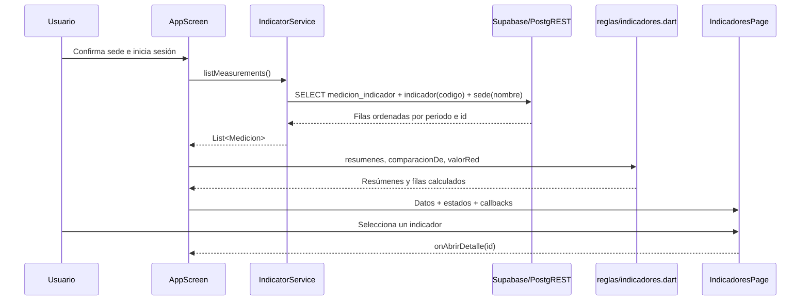

# ET-01 · Tablero de indicadores

## Alcance

Especifica la implementación técnica de `IndicadoresPage`, que presenta los cuatro indicadores, el promedio de red y la comparación por sede. La pantalla no consulta directamente Supabase ni contiene reglas de cálculo; recibe datos ya preparados desde `AppScreen`.

La fuente de datos se habilita solo cuando `main.dart` inicializa Supabase con `SUPABASE_URL` y `SUPABASE_PUBLISHABLE_KEY`. Sin configuración o si falla la inicialización, la aplicación selecciona el servicio en memoria y conserva el flujo de demostración.

## Componentes y responsabilidades

| Componente | Responsabilidad |
|---|---|
| `lib/main.dart` | Inicializa Supabase y crea `AuthSupabase` e `IndicatorSupabase`; sin cliente remoto deja los servicios a sus valores en memoria. |
| `lib/config/entorno.dart` | Lee URL y publishable key desde variables de compilación; no contiene credenciales. |
| `lib/screens/app_screen.dart` | Mantiene `_mediciones`, `_cargandoMediciones` y `_errorMediciones`; inicia la carga al abrir la sesión y al reintentar. |
| `lib/screens/app_screen_paginas.dart::_tablero` | Deriva resúmenes, promedios y comparación por sede usando las reglas compartidas, y construye `IndicadoresPage`. |
| `lib/services/indicator_service.dart` | Contrato `listMeasurements()` / `addMeasurement()` compartido por la fuente remota y la de memoria. |
| `lib/services/indicator_supabase.dart` | Lee mediciones desde PostgREST y adapta filas a `Medicion`. |
| `lib/services/indicator_memory.dart` | Devuelve las mediciones simuladas cuando no hay cliente remoto. |
| `lib/reglas/indicadores.dart` | Define indicadores, periodos, promedios, cambios, marcas y orden. |
| `lib/pages/indicadores_page.dart` | Renderiza el tablero y comunica la selección de un indicador mediante `onAbrirDetalle`. |
| `lib/widgets/carga.dart` | `CargaRemota` muestra carga/error de red; `CargaSimulada` conserva el modo de demostración. |

## Contrato de la pantalla

`IndicadoresPage` recibe `resumenes`, `sedesPorIndicador`, `promedios`, `periodo`, `cargando`, `hayError`, `onReintentar` y `onAbrirDetalle`. No conserva el conjunto de mediciones ni ejecuta consultas.

Las estructuras de presentación son `ResumenIndicador` y `FilaSede`, declaradas en `lib/modelos/indicadores.dart`. Los identificadores son `IdIndicador`; las sedes usan los ids del conjunto compartido de `DatosSimulados`.

## Flujo de datos

La lectura remota selecciona `periodo_inicio`, `valor`, `indicador(codigo)` y `sede(nombre)`, y ordena por `periodo_inicio` e `id_medicion`. El adaptador convierte el código a `IdIndicador`, el nombre de sede a su id local y la fecha a `DateTime`. Una sede o un indicador que no pueda mapearse provoca un error de carga; no se omite la fila silenciosamente.

Después de confirmar la sede, `_cargarMediciones()` trae la lista completa una vez y la conserva en el estado anfitrión. La pantalla obtiene sus datos por cálculo local:

- `ultimoPeriodo(_datos.hoy)` determina el mes cerrado más reciente.
- `resumenes(...)` crea un resumen por indicador con valor de red, cambio, resultado de mejora y tendencia.
- `valorRed(...)` calcula el promedio simple de sedes con dato en ese periodo.
- `comparacionDe(...)` devuelve solo las sedes aplicables, ordenadas de peor a mejor; las sedes sin dato quedan al final.
- `marcaDe(...)` compara valores redondeados a un decimal y respeta la dirección del indicador.

Los indicadores y sus metadatos de presentación se definen en `lib/reglas/indicadores.dart`; no se descargan de la tabla `indicador`. La fecha usada para los cálculos es `_datos.hoy`, que actualmente es la fecha fija simulada del 6 de noviembre de 2026.

## Persistencia y control de acceso

La migración `supabase/migraciones/009_indicadores.sql` define `indicador`, `indicador_tipo_sede` y `medicion_indicador`, relacionadas con `sede` y `usuario`. Para las lecturas del tablero, RLS permite consultar indicadores y mediciones a usuarios autenticados cuyo `rol_actual()` no sea nulo. La pantalla no contiene identificadores de pacientes.

La conexión requiere que el esquema base de usuarios, roles y sedes ya esté instalado, además de la migración 009. La publishable key no sustituye las políticas RLS; la secret key no se usa en el cliente.

## Estados y errores

| Estado | Responsable | Presentación |
|---|---|---|
| Cargando | `_cargarMediciones()` y `CargaRemota` | “Cargando indicadores…” |
| Listo | `IndicadoresPage` | Cuatro indicadores y su comparación por sede. |
| Error remoto | `_cargarMediciones()` | “No se pudo cargar el tablero”; *Reintentar* vuelve a llamar `listMeasurements()`. |
| Sin mediciones | Reglas y `IndicadoresPage` | Indicador sin promedio; sus sedes sin dato no entran al promedio. |
| Modo memoria | `IndicatorMemory` | Usa `DatosSimulados.mediciones`; no realiza llamadas de red. |

Los errores remotos se registran con `debugPrint`; la interfaz muestra un mensaje general y conserva el control de reintento.

## Dependencias y límites conocidos

- Los nombres de sede devueltos por la base deben coincidir con `DatosSimulados.sedes`, porque el adaptador los traduce a ids locales.
- La consulta no pagina ni limita los meses en el servidor; el conjunto completo se carga en memoria. Los cálculos visibles seleccionan los periodos que requieren F-08.
- La integración real no queda verificada por la existencia del código: requiere configuración local y migraciones desplegadas.
- La inicialización no configurada o fallida usa datos simulados. Un fallo de consulta con cliente activo muestra el estado de error remoto.
- Las reglas de autorización de lectura dependen de la sesión Supabase y RLS; el acceso al menú también depende del rol de la sesión de la app.

## Trazabilidad de validación

- Reglas: `test/indicadores_test.dart`, `test/indicadores_specs_test.dart`.
- Integración de carga y reintento: `test/indicadores_servicio_test.dart`.
- Spec funcional: `docs/specs/F-08-tablero-indicadores.md`.

## Historial

- 0.1.0 · 2026-11-26 · Primera versión técnica basada en el tablero y su integración actual.
