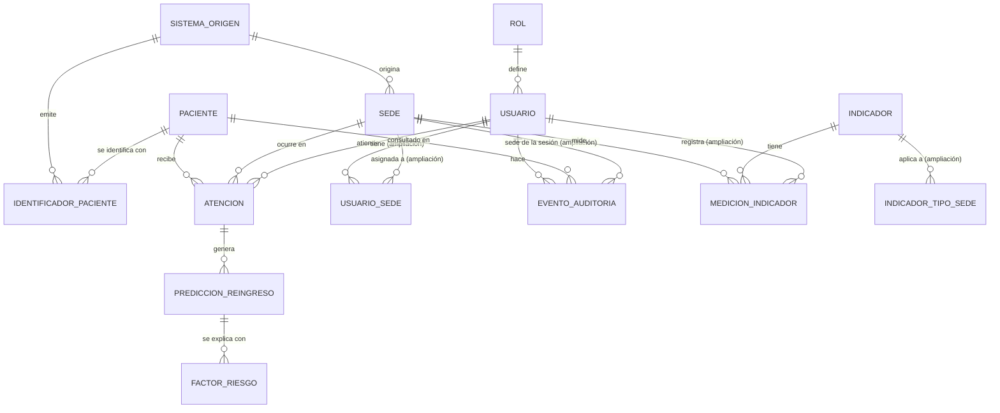

# Modelo de datos · Red Vitalys

Las tablas de Supabase (Postgres, con PostgREST). **Parte del MER que el equipo diseñó antes** (`Diagramaa_MER_Red_Vitalys.pdf`) y lo conserva: mismas tablas, mismos nombres y mismas relaciones. Lo que cambia son **ampliaciones** que los requisitos pidieron después del MER, o que Supabase exige; cada una está marcada con *(ampliación)* y su razón.

Es un borrador para revisar entre las cuatro personas antes de crear nada en Supabase.

## Diagrama

## Convenciones

- Los nombres siguen el MER: `snake_case` en español y llaves `id_<tabla>`.
- `NUMBER(10)` del MER pasa a `bigint generated always as identity`. `VARCHAR2` pasa a `text` con `check` donde el valor es de una lista. `CHAR(1)` de sí o no pasa a `boolean`. `DATE` con hora pasa a `timestamptz`.
- La **única llave que no es numérica** es `usuario.id_usuario`, que es el `uuid` de Supabase Auth (AD-04).

## Tablas del MER

### `sistema_origen`

| Columna | Tipo | Restricción |
|---|---|---|
| `id_sistema` | bigint | PK |
| `nombre` | text | no nulo |
| `tipo` | text | no nulo |

### `sede`

| Columna | Tipo | Restricción |
|---|---|---|
| `id_sede` | bigint | PK |
| `id_sistema` | bigint | FK a `sistema_origen`, no nulo |
| `nombre` | text | no nulo |
| `nombre_corto` | text | no nulo *(ampliación: lo muestra la app)* |
| `tipo_sede` | text | no nulo: `clinica`, `centro_ambulatorio`, `laboratorio` |
| `ciudad` | text | no nulo |

### `paciente`

| Columna | Tipo | Restricción |
|---|---|---|
| `id_paciente` | bigint | PK (el id unificado, AD-09) |
| `primer_nombre`, `primer_apellido` | text | no nulos |
| `segundo_nombre`, `segundo_apellido` | text | nulos |
| `fecha_nacimiento` | date | no nulo |
| `sexo` | char(1) | no nulo: `M` o `F` |
| `direccion` | text | nulo |
| `telefono` | text | nulo *(ampliación: F-03 lo muestra)* |

El nombre completo, la edad y las iniciales se arman en la app.

### `identificador_paciente` (AD-09)

| Columna | Tipo | Restricción |
|---|---|---|
| `id_identificador` | bigint | PK |
| `id_paciente` | bigint | FK a `paciente`, no nulo |
| `id_sistema` | bigint | FK a `sistema_origen`, no nulo |
| `tipo_documento` | text | no nulo: `CC`, `TI`, `RC` |
| `numero_identificacion` | text | no nulo |
| `es_principal` | boolean | no nulo, `default false` *(ampliación)* |

Único (`id_sistema`, `tipo_documento`, `numero_identificacion`). Hay a lo sumo un `es_principal` por paciente: es el documento que la app muestra en la lista y en la historia (ver pregunta 2).

### `rol`

`id_rol` (PK) y `nombre` (único): `medico`, `administrativo`, `auditor`.

### `usuario`

| Columna | Tipo | Restricción |
|---|---|---|
| `id_usuario` | uuid | PK y FK a `auth.users(id)` *(ampliación)* |
| `id_rol` | bigint | FK a `rol`, no nulo |
| `nombre_completo` | text | no nulo |
| `correo` | text | no nulo, único |
| `activo` | boolean | no nulo, `default true` |
| `foto_ruta` | text | nulo *(ampliación: foto de perfil, F-22)* |

**Se quita `contrasena_hash`**: la contraseña la guarda Supabase Auth, nunca la base de la app. El rol y las sedes salen de aquí y no de los metadatos de Auth (AD-04).

### `atencion`

| Columna | Tipo | Restricción |
|---|---|---|
| `id_atencion` | bigint | PK |
| `id_paciente` | bigint | FK a `paciente`, no nulo |
| `id_sede` | bigint | FK a `sede`, no nulo |
| `id_usuario` | uuid | FK a `usuario` (el médico), no nulo |
| `tipo_atencion` | text | no nulo: `hospitalizacion`, `urgencias`, `consulta_externa` |
| `fecha_inicio` | timestamptz | no nulo |
| `fecha_fin` | timestamptz | nulo; si hay, no es menor que `fecha_inicio` |
| `destino_alta` | text | nulo |
| `proposito` | text | no nulo *(ampliación)*: `seguimiento_reingreso`, `consulta_historia`, `atencion_paciente`, `revision_calidad`, `urgencia` |

`proposito` es necesario para RF-19 y RF-25. El estado (*En curso* o *Finalizada*) y los días de estancia **no se guardan**: salen de `fecha_fin` y de las dos fechas.

La **relación médico-paciente** (RF-25) es una vista, no una tabla: los pares (`id_usuario`, `id_paciente`) con una atención de propósito `atencion_paciente`. Una de `urgencia` no da relación.

### `prediccion_reingreso` y `factor_riesgo` (AD-10)

`prediccion_reingreso`: `id_prediccion` (PK), `id_atencion` (FK), `score_riesgo` (numeric(5,2), entre 0 y 100) y `fecha_prediccion` (date). La app muestra la más reciente del paciente.

`factor_riesgo`: `id_factor` (PK), `id_prediccion` (FK), `variable` (text) y `contribucion` (numeric(8,4), con signo: positiva sube el riesgo y negativa lo baja).

**Se quita `alerta_alto_riesgo`** (ampliación): la alerta es `score_riesgo >= 70` y el umbral se define en un solo lugar (AD-10). Guardarla permitiría que dos valores se contradigan.

### `indicador`

| Columna | Tipo | Restricción |
|---|---|---|
| `id_indicador` | bigint | PK |
| `codigo` | text | no nulo, único *(ampliación)*: `reingreso`, `espera`, `adherencia`, `eventos` |
| `nombre` | text | no nulo |
| `categoria` | text | no nulo: *Resultado*, *Estructura*, *Proceso* |
| `unidad_medida` | text | no nulo |
| `descripcion`, `unidad_cambio` | text | no nulos *(ampliación)* |
| `valor_minimo`, `valor_maximo` | numeric | no nulos *(ampliación)*, para validar (AD-11) |
| `direccion` | text | no nulo *(ampliación)*: `mas_bajo_es_mejor` o `mas_alto_es_mejor` |

`indicador_tipo_sede` *(ampliación)*: (`id_indicador`, `tipo_sede`), PK compuesta. Los laboratorios no tienen filas.

### `medicion_indicador`

| Columna | Tipo | Restricción |
|---|---|---|
| `id_medicion` | bigint | PK |
| `id_indicador` | bigint | FK a `indicador`, no nulo |
| `id_sede` | bigint | FK a `sede`, no nulo |
| `periodo_inicio`, `periodo_fin` | date | no nulos: primer y último día del mes |
| `valor` | numeric(12,4) | no nulo; `check` de máximo 1 decimal *(ampliación, RF-29)* |
| `registrada_por` | uuid | FK a `usuario`, nulo en las cargadas de origen *(ampliación)* |
| `registrada_en` | timestamptz | `default now()` *(ampliación)* |

Único (`id_indicador`, `id_sede`, `periodo_inicio`): no se repite una medición. El rango y que el mes ya haya terminado los valida el servicio de indicadores (AD-11).

### `evento_auditoria` (AD-07, AD-08, AD-15)

| Columna | Tipo | Restricción |
|---|---|---|
| `id_evento` | bigint | PK |
| `id_usuario` | uuid | FK a `usuario`. **Nulo** en un inicio de sesión fallido *(cambia: en el MER era obligatorio)* |
| `id_paciente` | bigint | FK a `paciente`, nulo |
| `fecha_hora_evento` | timestamptz | no nulo, `default now()` |
| `accion` | text | no nulo: `ingresar`, `consultar`, `registrar` |
| `tipo_recurso` | text | no nulo: los 8 de F-20 |
| `resultado` | text | no nulo: `permitido`, `denegado` |
| `proposito_uso` | text | **nulo** significa *No aplica* *(cambia: en el MER era obligatorio)* |
| `id_sede` | bigint | FK a `sede`, nulo *(ampliación)* |
| `correo_intento` | text | nulo, solo en un inicio fallido *(ampliación, RF-31)* |
| `ip` | inet | nulo; la pone la base *(ampliación, AD-15)* |

**Solo agregar y leer (AD-08, RF-17):** RLS activa con políticas solo de `insert` y `select`, sin `update` ni `delete`; además `revoke update, delete` al rol de la API y un trigger `before update or delete` que lanza un error. La IP sale de un `default` que lee `x-forwarded-for` en `request.headers`; la app no manda ese campo.

`es_emergencia` no se guarda: es `proposito_uso = 'urgencia' and resultado = 'permitido'` (F-17).

### `usuario_sede` *(ampliación, RF-18)*

`id_usuario` (FK) e `id_sede` (FK), PK compuesta. Un usuario sin filas no puede ingresar (F-13 A3).

## Storage (F-22)

- **Bucket** `fotos-perfil`, privado; la foto se ve con una URL firmada de corta duración.
- **Ruta** `<id_usuario>/foto.<ext>`, guardada en `usuario.foto_ruta`. Cada usuario solo escribe dentro de su carpeta.
- JPG o PNG de hasta 2 MB.

## Quién escribe cada tabla

| Tabla | Cuándo cambia | Funcionalidad |
|---|---|---|
| `usuario`, `usuario_sede` | Registro de usuarios; la foto, desde el perfil | F-13, F-22 |
| `atencion` | Al registrar una atención | F-04 |
| `medicion_indicador` | Al registrar una medición | F-12 |
| `evento_auditoria` | Cada acción sobre un paciente, medición, ingreso y acción denegada | F-20 |
| El resto | Solo la carga inicial (`seed`) con los datos simulados de `lib/datos/` (RNF-04) | |

## Seguridad (RLS)

La spine difiere RLS hasta usar datos reales. Se propone activarla desde ya en `evento_auditoria` y en el bucket, por su propia regla; en el resto se decide en la reunión.

## Preguntas abiertas

1. **Puntaje de riesgo.** El MER guarda `contribucion` con 4 decimales y la app muestra puntos enteros con signo (F-07). ¿Guardamos enteros?
2. **Documento principal del paciente.** El MER pone el documento en `identificador_paciente`, uno por sistema de origen. La app muestra uno solo. Propuesta: `es_principal`. ¿O es el del sistema propio de Red Vitalys?
3. **Registro de usuarios (nuevo).** ¿Quién elige el rol y las sedes de una cuenta nueva? Resuelto: al registrar un usuario en Auth, un trigger (`tr_crear_usuario_nuevo`) crea su fila en `public.usuario` con rol `medico` por defecto y sin sedes asignadas en `usuario_sede` (principio de menor privilegio). Si intenta ingresar antes de que se le asignen sedes, la app aplica el flujo alterno F-13 A3 ("Su cuenta no tiene sedes asignadas"). Alguien con privilegios asigna sus sedes en `usuario_sede` para habilitar el ingreso.
4. **Intentos fallidos por IP (AD-14).** ¿Se cuentan en la base o se mantiene el bloqueo por dispositivo? Resuelto: se mantiene el bloqueo local en el cliente (5 intentos fallidos consecutivos bloquean durante 15 minutos en el dispositivo según F-14), mientras que cada intento fallido persiste su evento denegado en `public.evento_auditoria` con la IP obtenida por Postgres (AD-15).
5. **Atención.** ¿Qué campos más tiene el formulario de F-04 (motivo, notas)? Hoy no se guardan.
6. **Descripción del periodo del riesgo** ("30 días tras el alta"). Hoy es un texto de la app. ¿Se deja fijo en la app?

## Historial

- 0.1.0 · 2026-11-23 · Primer borrador, desde los modelos de la app.
- 0.2.0 · 2026-11-23 · Reescrito desde el MER del equipo: se conservan sus tablas y nombres y se marcan las ampliaciones.
